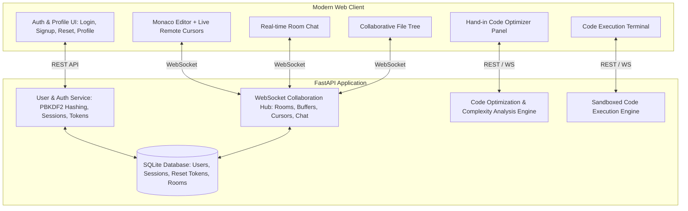

# Collaborative Coding Platform with User Management, AI Code Optimizer, and Real-Time Collaboration

Build a full-featured, modern web-based collaborative coding platform. The platform features complete user authentication and profiles, a Monaco-powered code editor with automated/hand-in code optimization suggestions, and real-time multi-user room synchronization.

---

## Architecture Overview

---

## User Review Required

> [!IMPORTANT]
> **Authentication & Email Delivery**:
> In a local development environment, real email delivery typically requires external SMTP credentials (like SendGrid or Gmail). To ensure seamless local testing without setup barriers, we will implement:
> 1. Complete cryptographic email verification and password reset token generation.
> 2. A built-in **Developer Email Outbox / Notification Toast** in the app where generated verification and reset links are immediately viewable and clickable with one click, along with standard SMTP support if environment variables are provided.

> [!NOTE]
> **Code Optimizer Architecture**:
> We implement a built-in **Algorithmic Complexity & Optimization Engine** (detecting $O(N^2)$ to $O(N)$ improvements, dict lookups over linear scans, generator/comprehension optimizations, recursion memoization, and anti-patterns) with ready-to-apply diffs and explanations. We will also include an optional Google Gemini API hook for extended free-form AI optimization if an API key is configured.

---

## Proposed Changes

### 1. Database & Authentication Engine

#### [NEW] [database.py](file:///c:/Users/upadh/OneDrive/Documents/ANTIGRAVITY/database.py)
- SQLite database schema with thread-safe connection pooling:
  - `users`: `id` (e.g. `usr_9f4e2b81`), `username`, `email`, `password_hash`, `salt`, `is_verified`, `bio`, `avatar_url`, `created_at`.
  - `sessions`: `token`, `user_id`, `expires_at`.
  - `email_verification_tokens`: `token`, `user_id`, `created_at`, `expires_at`.
  - `password_reset_tokens`: `token`, `user_id`, `created_at`, `expires_at`.
  - `rooms`: `room_id`, `name`, `created_by`, `created_at`, `settings`.
- Cryptographic password hashing using `hashlib.pbkdf2_hmac` with SHA256 and unique random salt per user.
- Methods for user registration, credential verification, session validation, profile updates, email verification confirmation, and password reset flows.

---

### 2. Hand-in Code Optimizer Engine

#### [NEW] [optimizer.py](file:///c:/Users/upadh/OneDrive/Documents/ANTIGRAVITY/optimizer.py)
- AST-based and heuristic code analyzer for Python and JavaScript.
- Identifies common performance bottlenecks:
  - Nested loops performing repetitive linear scans vs hash set / dict lookups ($O(N^2) \to O(N)$).
  - Unmemoized naive recursive algorithms (e.g., Fibonacci, permutation search) suggesting dynamic programming / memoization ($O(2^N) \to O(N)$).
  - Inefficient string concatenations in tight loops vs `.join()`.
  - Repetitive I/O or redundant database/query calls inside loops.
  - Sorting inside loops vs pre-sorting.
- Generates structured hand-in suggestion objects:
  - `issue`: Description of the bottleneck (e.g., "Quadratic search inside loop detected").
  - `complexity_before`: Estimated time/space complexity (e.g., $O(N^2)$).
  - `complexity_after`: Estimated optimized complexity (e.g., $O(N)$).
  - `explanation`: Educational hand-in breakdown explaining why the optimization helps.
  - `optimized_code`: Ready-to-apply refactored code.
- Optional Gemini LLM integration fallback when `GEMINI_API_KEY` is provided.

---

### 3. Real-Time Collaboration & Room Hub

#### [NEW] [collab_hub.py](file:///c:/Users/upadh/OneDrive/Documents/ANTIGRAVITY/collab_hub.py)
- In-memory state manager for active rooms:
  - Multi-file virtual file tree per room (`main.py`, `utils.py`, `index.html`, etc.).
  - Real-time document buffer tracking with client revision IDs.
  - Connected user roster per room (user ID, username, color, cursor position, active file).
  - Chat message log per room.
- WebSocket event dispatcher:
  - `code_change`: Synchronizes keystrokes / text buffer edits across peers.
  - `cursor_move`: Transmits cursor line/column and selection ranges.
  - `file_tree`: Synchronizes adding, deleting, and renaming files.
  - `chat_message`: Broadcasts room discussion messages.
  - `presence`: Broadcasts join / leave and active file status.
  - `apply_optimization`: Broadcasts applied code optimization to all collaborators.

---

### 4. Code Execution Engine

#### [NEW] [executor.py](file:///c:/Users/upadh/OneDrive/Documents/ANTIGRAVITY/executor.py)
- Sandboxed subprocess execution for Python and JavaScript code.
- Captures stdout, stderr, execution time, and exit status.
- Implements execution timeouts (e.g., 5 seconds) to prevent infinite loops.

---

### 5. Backend Server & APIs

#### [NEW] [server.py](file:///c:/Users/upadh/OneDrive/Documents/ANTIGRAVITY/server.py)
- FastAPI application orchestrating all subsystems:
  - Authentication endpoints:
    - `POST /api/auth/signup`: Create user, dispatch verification token.
    - `POST /api/auth/login`: Authenticate and issue session token.
    - `POST /api/auth/logout`: Invalidate session.
    - `GET /api/auth/me`: Get current authenticated user details.
    - `POST /api/auth/verify-email`: Confirm verification token.
    - `POST /api/auth/forgot-password`: Dispatch password reset token.
    - `POST /api/auth/reset-password`: Reset password using token.
    - `PUT /api/auth/profile`: Update bio, username, avatar.
  - Code Optimization endpoint:
    - `POST /api/optimize`: Accepts code, language, and returns structured hand-in suggestions.
  - Code Execution endpoint:
    - `POST /api/execute`: Runs code and returns execution output.
  - Room Management:
    - `POST /api/rooms`: Create room.
    - `GET /api/rooms/{room_id}`: Get room metadata.
  - WebSocket endpoint:
    - `WS /ws/{room_id}`: Full duplex collaboration channel.
  - Static files hosting for the frontend application.

---

### 6. Frontend UI Application

#### [NEW] [static/index.html](file:///c:/Users/upadh/OneDrive/Documents/ANTIGRAVITY/static/index.html)
- Modern, professional developer workspace layout (VS Code / Dark theme aesthetic):
  - **Header Bar**: Brand logo, room indicator, room share button, run code button, "Optimize Code" button with badge, user profile pill & dropdown.
  - **Authentication Modals**:
    - Sign Up modal with email validation & username checker.
    - Login modal with "Forgot Password" link.
    - Password Reset & Email Verification modal dialogues.
    - User Profile modal (displaying unique user ID `usr_...`, joined date, stats, editable bio and avatar).
    - In-app Dev Mailbox drawer (shows verification links and password reset links for instantaneous testing).
  - **Left Sidebar**:
    - Collapsible file explorer (add file, delete file, active file switch).
    - Collaborator roster (online users, color badges, active file status).
  - **Center Area**:
    - File tabs (`main.py`, `helper.py`).
    - Monaco Editor container with multi-cursor rendering and color-coded remote user flags.
  - **Right Drawer / Split Panel**:
    - **Hand-in Code Optimizer Panel**: Displays detected inefficiencies, Big-O complexity comparison, educational explanations, and one-click "Apply to Editor" button.
    - **Live Room Chat**: Messages, collaborator badges, timestamps.
  - **Bottom Dock**:
    - Interactive Terminal / Output console displaying stdout, stderr, run time, and return code.

#### [NEW] [static/css/styles.css](file:///c:/Users/upadh/OneDrive/Documents/ANTIGRAVITY/static/css/styles.css)
- Sleek modern developer styling (dark theme, glassmorphism accents, responsive grid/flex layout, custom scrollbars, syntax-aware badge highlights, and animations for remote cursors).

#### [NEW] [static/js/api.js](file:///c:/Users/upadh/OneDrive/Documents/ANTIGRAVITY/static/js/api.js)
- REST client handling authentication, session tokens, user profile updates, code execution, and optimization requests.

#### [NEW] [static/js/collab.js](file:///c:/Users/upadh/OneDrive/Documents/ANTIGRAVITY/static/js/collab.js)
- WebSocket client handling connection, heartbeat, delta synchronization, remote cursor rendering in Monaco, file tree updates, and real-time chat.

#### [NEW] [static/js/optimizer.js](file:///c:/Users/upadh/OneDrive/Documents/ANTIGRAVITY/static/js/optimizer.js)
- UI controller for the "Hand-in Suggestion on Optimized Code" panel: handles diff preview, side-by-side or inline view, and one-click injection into the Monaco editor.

#### [NEW] [static/js/app.js](file:///c:/Users/upadh/OneDrive/Documents/ANTIGRAVITY/static/js/app.js)
- Main application orchestrator: initializes Monaco Editor from CDN, hooks tab switching, runs code, manages state, and initializes auth modal workflows.

---

## Verification Plan

### Automated Tests
1. **Authentication & User Management Tests**:
   - Create `test_auth.py` verifying:
     - User signup and unique user ID generation (`usr_...`).
     - Duplicate username / email prevention.
     - Login with correct vs incorrect password.
     - Email verification token validation.
     - Password reset token flow and password change verification.
     - User profile fetching and updating.
   - Run: `python test_auth.py`

2. **Code Optimizer & Complexity Analysis Tests**:
   - Create `test_optimizer.py` verifying:
     - Optimization of $O(N^2)$ nested search to $O(N)$ set/dict lookup.
     - Optimization of unmemoized recursive Fibonacci to DP/memoized version.
     - String concatenation in loop optimization.
   - Run: `python test_optimizer.py`

3. **WebSocket Collaboration & Room Tests**:
   - Create `test_collab.py` verifying:
     - Multi-client WebSocket room connection.
     - Real-time text buffer synchronization between two clients.
     - Cursor position broadcast and active user presence updates.
   - Run: `python test_collab.py`

### Manual Verification
1. Start the server: `python server.py`.
2. Open `http://localhost:8000` in Browser Tab 1:
   - Click "Sign Up", create an account (e.g. `coder1` / `coder1@example.com`).
   - Check user profile to see generated unique user ID `usr_...` and edit bio.
   - Test password reset flow using the in-app verification preview.
3. Create or join a Room (e.g., `room-dev-42`).
4. Open `http://localhost:8000?room=room-dev-42` in Browser Tab 2 (Incognito):
   - Sign up/Login as `coder2`.
   - Verify both users appear in the room roster with distinct colors.
   - Type in Tab 1 and verify real-time typing sync in Tab 2.
   - Move cursor and verify live remote cursor flag in Tab 2.
5. In Tab 1, enter an unoptimized code snippet (e.g. nested search loop or recursive fibonacci).
6. Click "Analyze & Optimize" in the editor toolbar.
7. Inspect the "Hand-in Suggestion on Optimized Code" card:
   - Check before/after complexity rating (e.g. $O(N^2) \to O(N)$).
   - Click "Apply Optimization" and verify the code updates automatically in both Tab 1 and Tab 2!
8. Click "Run Code" and verify output appears in the execution terminal.
